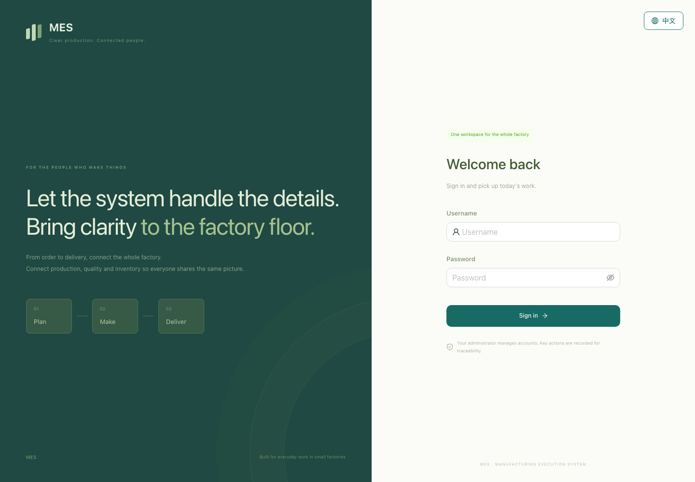
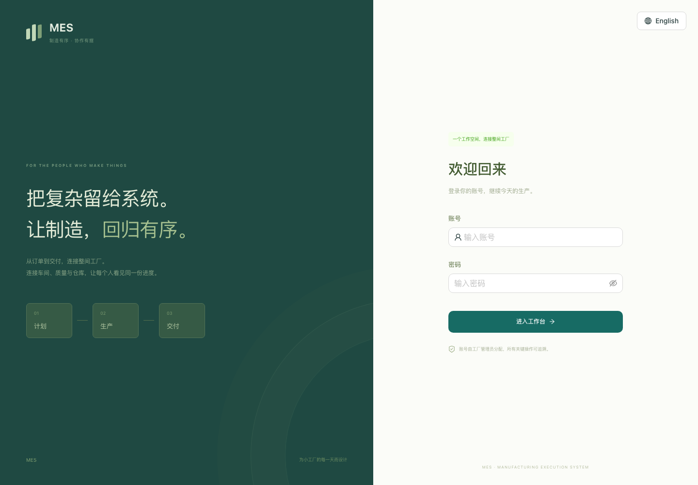

# MES

https://github.com/user-attachments/assets/b38a41e0-2bfe-47ec-8c7a-f385fe757648

<p align="center">
  <a href="#english"><b>English</b></a> · <a href="#简体中文"><b>简体中文</b></a> · <a href="https://yucheng-du.github.io/MES/">🌐 Website / 项目网站</a>
</p>

<p align="center">
  <a href="https://github.com/yucheng-du/MES/actions/workflows/ci.yml"></a>
  <a href="LICENSE"></a>
  
</p>

<p align="center"><sub>React + TypeScript · Fastify + PostgreSQL · Kotlin</sub></p>

---

## English

An open-source manufacturing execution system for small factories, connecting orders, shop floor work, quality, inventory and pay. Includes a Chinese/English interface and an Android companion.

### ⚙️ Core features

- **Production:** product routes, orders, task assignments and shop floor reporting.
- **Quality and pay:** inspections, scrap, automatic review, piecework and hourly pay.
- **Stock and purchasing:** goods and material movements, purchase requests and partial payments.
- **Equipment:** operating statistics, maintenance checks, Andon, scanning and optional label printing.
- **Teamwork:** work tasks, personnel profiles, access controls and an audit trail.



<a id="quick-start"></a>

### 🚀 Quick start

Requires **Node.js 22.13+, npm and PostgreSQL 17**, with `initdb`, `pg_ctl`, `psql` and `createdb` on `PATH`.

```bash
git clone https://github.com/yucheng-du/MES.git
cd MES
npm ci
npm run db:local
npm run db:migrate
npm run db:seed
npm run dev
```

Open [localhost:5173](http://localhost:5173). Sign in with `admin` / `MesDemo2026!` for local development only.

Stop the local database with `npm run db:stop`. For existing databases, see [API setup](apps/api/README.md).

### 📚 Documentation

[Features](docs/FEATURES.md) · [Deployment and backups](docs/DEPLOYMENT.md) · [Automatic review](docs/AUTO-REVIEW.md) · [Android](apps/android/README.md) · [Testing](docs/TESTING.md) · [API](docs/API-CONTRACT.md)

<p align="right"><a href="#mes">↑ Back to top</a></p>

---

## 简体中文

[English](#english)

面向小工厂的开源制造执行系统，连接订单、车间生产、质量、库存和工资。提供中英文界面及 Android 客户端。

### ⚙️ 核心功能

- **生产**：产品工艺、订单排产、任务分派与车间报工。
- **质量与工资**：检验、报废、自动审核、计件与计时工资。
- **库存与采购**：成品和物料出入库、采购申请与分次付款。
- **设备现场**：设备统计、点检保养、安灯、扫码与可选标签打印。
- **团队协作**：工作任务、人员档案、分级权限与操作审计。



<a id="快速启动"></a>

### 🚀 快速启动

需要 **Node.js 22.13+、npm、PostgreSQL 17**，并将 `initdb`、`pg_ctl`、`psql`、`createdb` 加入 `PATH`。

```bash
git clone https://github.com/yucheng-du/MES.git
cd MES
npm ci
npm run db:local
npm run db:migrate
npm run db:seed
npm run dev
```

打开 [localhost:5173](http://localhost:5173)，演示账号为 `admin` / `MesDemo2026!`，仅供本地开发使用。

用 `npm run db:stop` 停止本地数据库；已有数据库的配置见 [API 说明](apps/api/README.zh-CN.md)。

### 📚 文档

[功能](docs/FEATURES.zh-CN.md) · [部署与备份](docs/DEPLOYMENT.zh-CN.md) · [自动审核](docs/AUTO-REVIEW.zh-CN.md) · [Android](apps/android/README.zh-CN.md) · [测试](docs/TESTING.zh-CN.md) · [API](docs/API-CONTRACT.zh-CN.md)

<p align="right"><a href="#mes">↑ 回到顶部</a></p>

---

<p align="center">
  <a href="LICENSE">MIT</a> · <a href="CONTRIBUTING.md">🤝 Contributing / 参与贡献</a> · <a href="SECURITY.md">🛡️ Security / 安全反馈</a>
  <br>
  <a href="https://yucheng-du.github.io/MES/">🌐 Website / 项目网站</a> · <a href="docs/MEDIA-CREDITS.md">♫ Media credits / 媒体来源</a>
</p>
